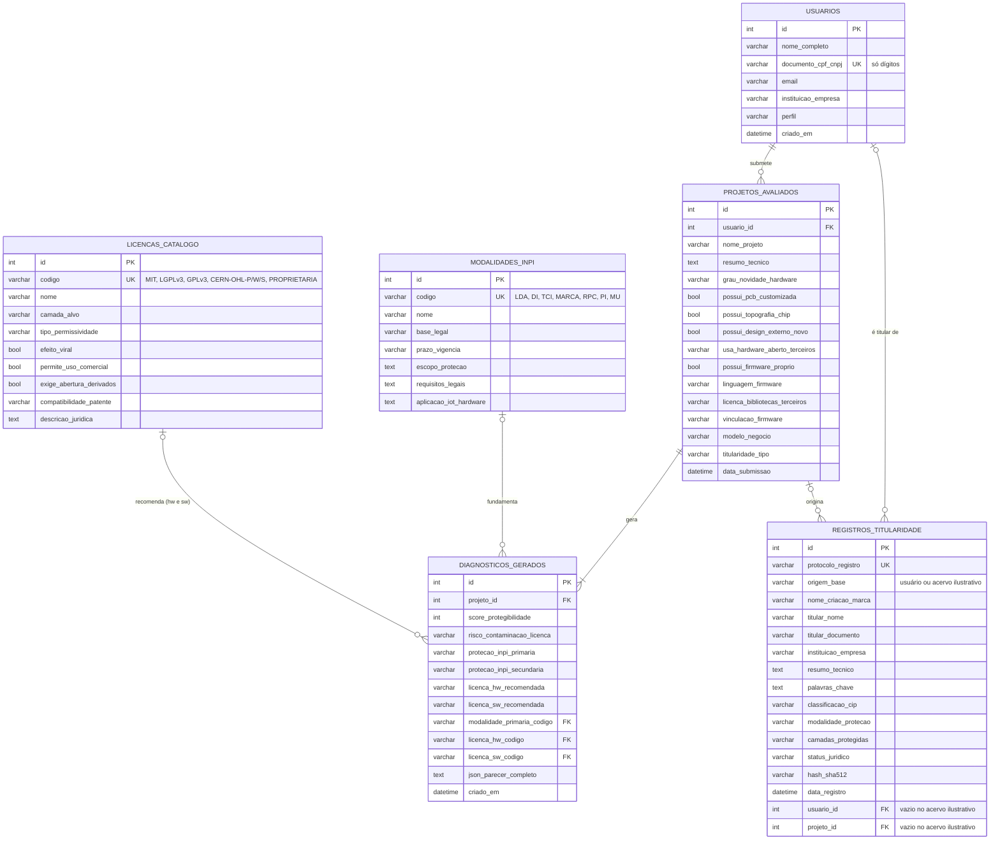
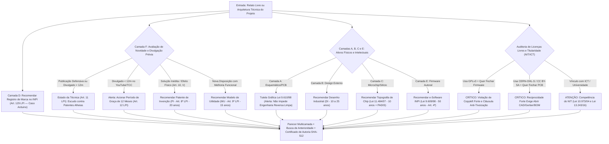

# Modelagem de Dados (DER) e Árvore de Decisão Jurídico-Técnica (Matriz A–F)
**Projeto 3: Observatório de Propriedade Intelectual e Hardware Aberto**  
**Equipe ("Os Cara"):** Antonio Kayky Gonçalves Vieira, Giullian Bernard Alencar Maia, Ítalo Brito da Costa e Luís Aquiles Lucena Sá

Este documento consolida o **Artefato de Modelagem (DER)** e a **Árvore Lógica do Motor de Decisão** fundamentados na Matriz de 6 Camadas do Hardware (**Camadas A a F**) definida na Entrega 1 da equipe:
- **Camada A (Documentação Técnica):** Direito Autoral sobre esquemáticos, PCB e manuais (*Lei nº 9.610/1998 — LDA*);
- **Camada B (Design do Produto):** Desenho Industrial (*Lei nº 9.279/1996 — Art. 94 a 121*, 10 a 25 anos);
- **Camada C (Semicondutores):** Topografia de Circuito Integrado (*Lei nº 11.484/2007 e PADIS*, 10 anos);
- **Camada D (Signos Distintivos):** Registro de Marca no INPI (*Lei nº 9.279/1996 — Arts. 129 e 189*; vigência de 10 anos renováveis — Art. 133);
- **Camada E (Software Embarcado):** Direito Autoral de Software (*Lei nº 9.609/1998 — Art. 4º*, 50 anos);
- **Camada F (Solução Técnica):** Patente de Invenção (20 anos) ou Modelo de Utilidade (15 anos), observada a ressalva do *Art. 10, V da LPI* para processos técnicos com efeito físico, a *Publicação Defensiva (Art. 11 LPI)* e o *Período de Graça de 12 meses (Art. 12 LPI)*.

---

## 1. Diagrama Entidade-Relacionamento (DER)

Os diagramas completos estão em **`docs/der/`**:

| Arquivo | Conteúdo |
|---|---|
| `DER_Observatorio_PI.pdf` | Capa, DER conceitual, DER lógico, dicionário de dados e decisões de modelagem |
| `der-conceitual.svg` / `.png` | DER conceitual (notação de Peter Chen, no estilo do brModelo, cardinalidade (mín,máx)) |
| `der-logico.svg` / `.png` | DER lógico (notação pé de galinha, no estilo do MySQL Workbench, com PK, FK e valores únicos) |

Os diagramas foram gerados a partir do banco real (`database/schema.sql`), então correspondem exatamente às tabelas do sistema. Os arquivos SVG podem ser abertos e editados no Figma, no draw.io ou no navegador.

### 1.1 DER lógico (resumo em Mermaid)

### 1.2 Cardinalidades (leitura)

- Um **usuário** submete (0,N) projetos; cada projeto pertence a (1,1) usuário.
- Um **projeto** gera (1,N) diagnósticos; cada diagnóstico é de (1,1) projeto.
- Um **diagnóstico** referencia (0,1) modalidade principal e (0,1) licença de hardware e (0,1) de software nos catálogos.
- Uma **prova de autoria** pertence a (0,1) usuário e vem de (0,1) projeto — é opcional porque os 15 itens do acervo ilustrativo não pertencem a ninguém.

---

## 2. Fluxograma do Motor de Decisão Multicritério (Camadas A a F)

