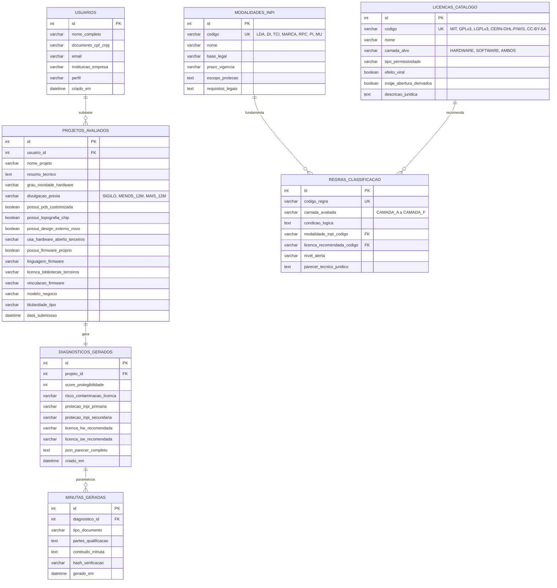

# Modelagem de Dados (DER) e Árvore de Decisão Jurídico-Técnica (Matriz A–F)
**Projeto 3: Observatório de Propriedade Intelectual e Hardware Aberto**  
**Equipe ("Os Cara"):** Antonio Kayky Gonçalves Vieira, Giullian Bernard Alencar Maia, Ítalo Brito da Costa e Luís Aquiles Lucena Sá

Este documento consolida o **Artefato de Modelagem (DER)** e a **Árvore Lógica do Motor de Decisão** fundamentados na Matriz de 6 Camadas do Hardware (**Camadas A a F**) definida na Entrega 1 da equipe:
- **Camada A (Documentação Técnica):** Direito Autoral sobre esquemáticos, PCB e manuais (*Lei nº 9.610/1998 — LDA*);
- **Camada B (Design do Produto):** Desenho Industrial (*Lei nº 9.279/1996 — Art. 94 a 121*, 10 a 25 anos);
- **Camada C (Semicondutores):** Topografia de Circuito Integrado (*Lei nº 11.484/2007 e PADIS*, 10 anos);
- **Camada D (Signos Distintivos):** Registro de Marca no INPI (*Lei nº 9.279/1996 — Art. 129 e 189*, 10 anos renováveis indefinidamente);
- **Camada E (Software Embarcado):** Direito Autoral de Software (*Lei nº 9.609/1998 — Art. 4º*, 50 anos);
- **Camada F (Solução Técnica):** Patente de Invenção (20 anos) ou Modelo de Utilidade (15 anos), observada a ressalva do *Art. 10, V da LPI* para processos técnicos com efeito físico, a *Publicação Defensiva (Art. 11 LPI)* e o *Período de Graça de 12 meses (Art. 12 LPI)*.

---

## 1. Diagrama Entidade-Relacionamento (DER)



---

## 2. Fluxograma do Motor de Decisão Multicritério (Camadas A a F)

```mermaid
flowchart TD
    A["Entrada: Relato Livre ou Arquitetura Técnica do Projeto"] --> D["Camada D: Recomendar Registro de Marca no INPI (Art. 129 LPI — Caso Arduino)"]
    A --> B{"Camada F: Avaliação de Novidade e Divulgação Prévia"}
    B -->|Publicação Defensiva ou Divulgado > 12m| B1["Estado da Técnica (Art. 11 LPI): Escudo contra Patentes Alheias"]
    B -->|Divulgado < 12m no YouTube/TCC| B2["Alerta: Acionar Período de Graça de 12 Meses (Art. 12 LPI)"]
    B -->|Solução Inédita / Efeito Físico (Art. 10, V)| C["Recomendar Patente de Invenção (PI - Art. 8º LPI - 20 anos)"]
    B -->|Nova Disposição com Melhoria Funcional| M["Recomendar Modelo de Utilidade (MU - Art. 9º LPI - 15 anos)"]

    A --> F{"Camadas A, B, C e E: Ativos Físicos e Intelectuais"}
    F -->|Camada A: Esquemático/PCB| FA["Tutela Gráfica Lei 9.610/98 (Alerta: Não Impede Engenharia Reversa Limpa)"]
    F -->|Camada B: Design Externo| FB["Recomendar Desenho Industrial (DI - 10 a 25 anos)"]
    F -->|Camada C: Microchip/Silício| FC["Recomendar Topografia de Chip (Lei 11.484/07 - 10 anos + PADIS)"]
    F -->|Camada E: Firmware Autoral| FE["Recomendar e-Software INPI (Lei 9.609/98 - 50 anos - Art. 4º)"]

    A --> I{"Auditoria de Licenças Livres e Titularidade (NIT/ICT)"}
    I -->|Usa GPLv3 + Quer Fechar Firmware| J["CRÍTICO: Violação de Copyleft Forte e Cláusula Anti-Tivoização"]
    I -->|Usa CERN-OHL-S / CC BY-SA + Quer Fechar PCB| L["CRÍTICO: Reciprocidade Forte Exige Abrir CAD/Gerber/BOM"]
    I -->|Vínculo com ICT / Universidade| K["ATENÇÃO: Competência do NIT (Lei 10.973/04 e Lei 13.243/16)"]

    D & B1 & B2 & C & M & FA & FB & FC & FE & J & L & K --> N["Emissão do Parecer Multicamada + 4 Minutas Contratuais Automatizadas"]
```
